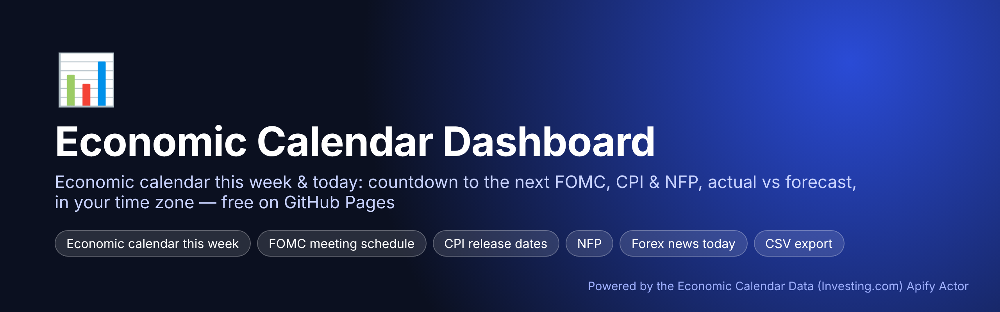
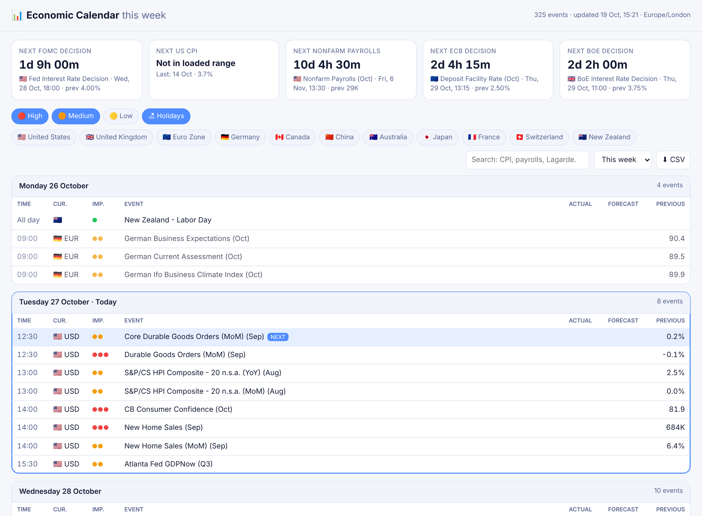
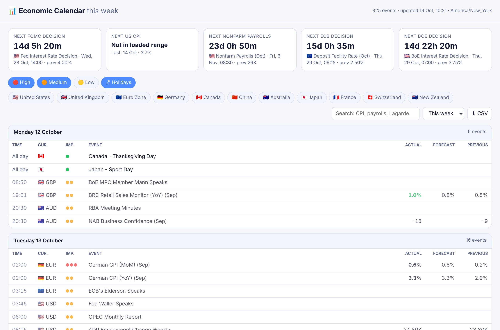

<p align="center"></p>

# Economic Calendar Dashboard — This Week, Today, FOMC / CPI / NFP Countdowns

A fast, free **economic calendar web app** you can host on GitHub Pages in minutes. It answers the questions traders and investors google every day:

- **What's on the economic calendar today / this week?**
- **When is the next FOMC meeting?** (Fed rate decision countdown)
- **When is the next CPI release? When is NFP?**
- **ECB / BoE rate decision dates**, actual vs forecast, beat or miss

**🔗 Live demo: https://belnaruto.github.io/economic-calendar-dashboard/**

Data comes from the Investing.com economic calendar via the **[Economic Calendar Data (Investing.com) Apify Actor](https://apify.com/pintostudio/economic-calendar-data-investing-com)**, refreshed hourly by GitHub Actions.

<p align="center"></p>

## Features

- ⏱ Live **countdowns**: next FOMC decision, US CPI, Nonfarm Payrolls, ECB and BoE decisions
- 📅 **Today / This week / Next week** views, grouped by day, next event highlighted
- 🔴🟠🟡 Impact filters, 🌍 country chips, 🔎 search ("CPI", "Lagarde", "payrolls")
- 🟢/🔴 **Actual vs forecast** coloring (beat / miss)
- 🕒 Automatic **local time zone** (or force one with `?tz=America/New_York`)
- ⬇ **CSV export** of the filtered view (open in Excel / Google Sheets)
- Light & dark mode, mobile friendly, no framework, no build step (~10 KB of JS)

<p align="center"></p>

## Deploy your own (GitHub Pages)

1. **Fork** this repo.
2. Get an Apify API token: [Console → Settings → Integrations](https://console.apify.com/settings/integrations).
3. *Settings → Secrets and variables → Actions*: add secret **`APIFY_TOKEN`**. Optional variable **`COUNTRIES`** (e.g. `united states,euro zone,united kingdom,japan` or `all`).
4. *Settings → Pages → Source: GitHub Actions*.
5. *Actions → Update data & deploy dashboard → Run workflow.* Done: `https://<you>.github.io/economic-calendar-dashboard/`.

Without a token the site deploys with the bundled real sample data (12 Oct – 6 Nov 2026).

## Run locally

```bash
git clone https://github.com/BelNaruto/economic-calendar-dashboard
cd economic-calendar-dashboard
pip install -r requirements.txt

export APIFY_TOKEN=apify_api_xxx
python scripts/update_data.py --days-ahead 28        # fetch fresh events into site/data/events.json

cd site && python -m http.server 8000                 # open http://localhost:8000
```

Demo the countdowns at a fixed moment: `http://localhost:8000/?now=2026-10-27T09:00:00Z&tz=Europe/London`.

## How it works

```
GitHub Actions (hourly) ─► scripts/update_data.py ─► Apify API ─► Economic Calendar Data (Investing.com) Actor
                                     │ site/data/events.json
                                     ▼
                          GitHub Pages (static site/) ─► browser renders in the visitor's time zone
```

Actor input used by `scripts/update_data.py`:

```json
{ "countries": ["united states", "euro zone", "united kingdom", "japan", "germany", "china"],
  "fromDate": "2026-10-12", "toDate": "2026-11-16", "timeFilter": "time_only" }
```

**Cost:** the Actor is pay-per-result (~$10 / 1,000 events). Eleven major economies over 5 weeks is ~600–700 events per refresh; refresh every few hours instead of hourly, or set `COUNTRIES` / add `importance="high"` in `update_data.py`, to keep it cheap.

## Customize

- Countdown targets: edit `COUNTDOWNS` in `site/app.js` (any regex on the event title, e.g. `/RBA Interest Rate Decision/`).
- Embed it: drop `site/` into any website or WordPress page via an `<iframe>`.

## Related projects

- [economic-calendar-ics](https://github.com/BelNaruto/economic-calendar-ics) — subscribe in Google Calendar / Apple / Outlook
- [economic-calendar-alert-bot](https://github.com/BelNaruto/economic-calendar-alert-bot) — Telegram & Discord alerts before CPI / NFP / FOMC
- [economic-calendar-python](https://github.com/BelNaruto/economic-calendar-python) — Python API, CLI, Excel export, news filter for backtests

Not investment advice. MIT licensed.
